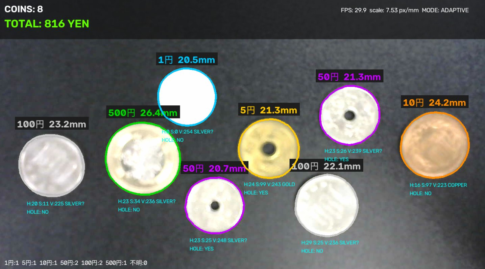
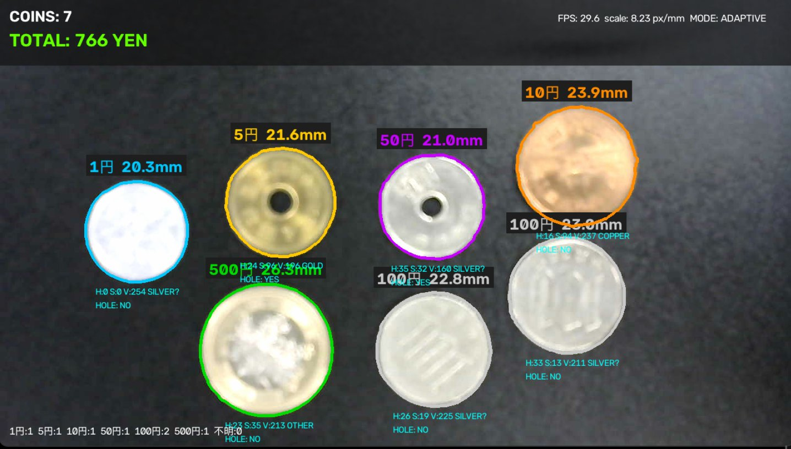
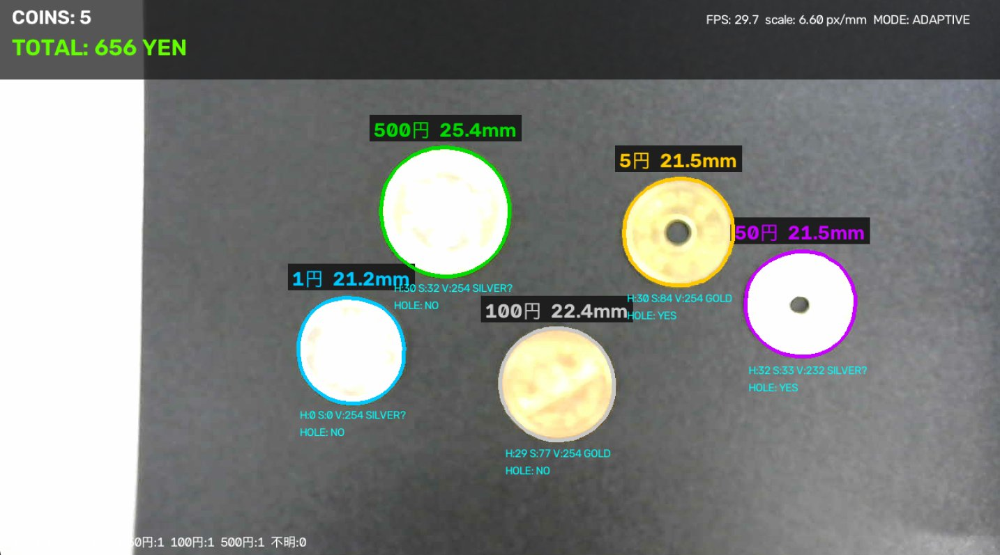
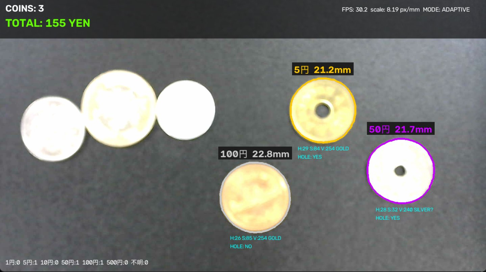
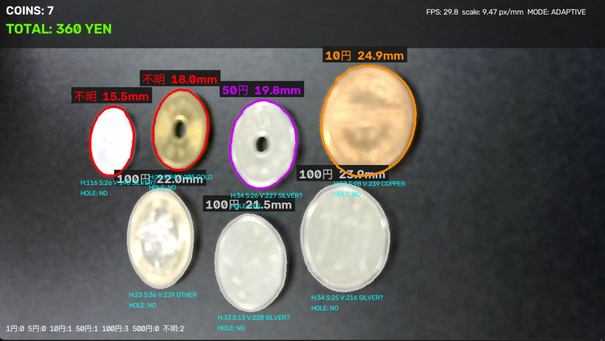
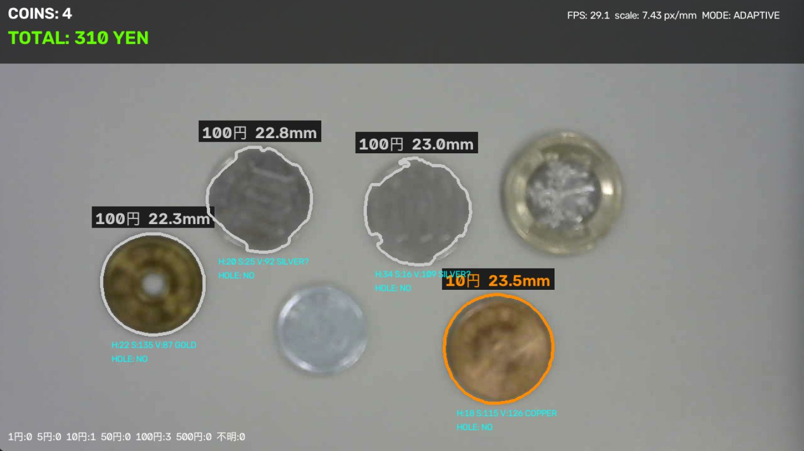
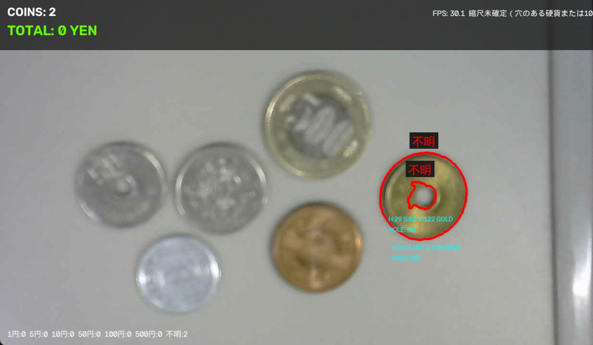

# 硬貨検出・自動集計アプリ（Python + OpenCV）

Webカメラの映像・録画動画・写真から日本の硬貨（1円・5円・10円・50円・100円・500円）を検出して分類し、枚数と合計金額を表示するアプリです。
大学の授業の課題で作りました。画像処理のみでCPU上で動きます（Webカメラ入力で約30 FPS）。



## 主な機能

- **入力**：Webカメラ／録画動画／写真（日本語を含むパスにも対応）
- **二値化**：大津法と適応的二値化を、実行中にキーで切り替えて比較できる
- **検出**：輪郭の面積・円形度（凸包の周囲長で計算）で硬貨を抽出する
- **分類**：穴の有無 → 色（HSV） → 直径の順に判定する
- **集計**：硬貨ごとの枚数と合計金額を画面に表示する
- **保存**：検出結果の画像と二値画像をファイルに保存できる

## 分類の仕組み

1. **前処理**：グレースケール化してガウシアンぼかしをかける
2. **二値化**：大津法（画面中央の領域だけで閾値を計算するオプションあり）または適応的二値化を使い、モルフォロジー処理でノイズを除去する
3. **硬貨の検出**：`RETR_TREE` で輪郭の親子関係を取得し、面積と円形度の条件を満たす輪郭を硬貨とする。輪郭の深さを数え、穴（奇数の深さ）だけを除外する
4. **穴の判定**：硬貨の中心付近に、決まった面積比の内側の輪郭があれば「穴あり」とする（5円・50円）
5. **縮尺の推定**：穴あり硬貨や10円候補の直径から px/mm を推定する
6. **金種の決定**
   - 穴あり：色が金色なら5円、それ以外は50円
   - 穴なし：赤銅色で直径が合えば10円、それ以外は直径が最も近い1円・100円・500円から選ぶ

## ファイル構成

| ファイル | 内容 |
|---|---|
| `coin_detection.py` | 基本版。硬貨同士が離れて置かれている場合を想定 |
| `watershed.py` | 改善版。距離変換とWatershed法で、くっついた硬貨を1枚ずつに分離する |

## 必要な環境

- Python 3.10 以上
- OpenCV（`opencv-python`）、NumPy
- Windows で動作を確認（カメラは DirectShow で開きます）

## 使い方

[uv](https://docs.astral.sh/uv/) を使う場合：

```bash
uv sync
uv run python coin_detection.py                    # Webカメラ（既定のカメラ番号）
uv run python coin_detection.py --camera 0         # カメラ番号を指定
uv run python coin_detection.py --video a.mp4      # 録画動画
uv run python coin_detection.py --image coins.jpg  # 写真
uv run python watershed.py --image coins.jpg       # くっついた硬貨を分離する改善版
```

pip を使う場合：

```bash
pip install -r requirements.txt
python coin_detection.py --image coins.jpg
```

### 操作キー

| キー | 動作 |
|---|---|
| `o` | 大津法に切り替え |
| `a` | 適応的二値化に切り替え |
| `b` | 背景が明るい／暗いの設定を切り替え（硬貨が白くならないとき） |
| `c` | 次のカメラ番号に切り替え（`coin_detection.py` のWebカメラ入力のみ） |
| `s` | 検出結果と二値画像を保存 |
| `q` | 終了 |

閾値や判定条件は、各ファイル冒頭の「設定部分」にまとめてあります。撮影環境に合わせて調整してください。

## 実行結果

黒い背景の上に硬貨を離して置いた場合は、照明にムラがあっても6種類すべての硬貨を正しく分類し、合計金額を出せました。



## 失敗例と原因

| 失敗例 | 原因 | 対策・改善の方向 |
|---|---|---|
|  | 照明が強く10円の表面が白飛びし、赤銅色と判定できず100円になった | 露出を下げる、色の判定に硬貨の縁だけを使う |
|  | 硬貨同士が接していると1つの輪郭になり、円形度の条件で除外される | `watershed.py` で距離変換とWatershed法により分離 |
|  | カメラを斜めから向けると硬貨が楕円に写り、直径の推定がずれる | カメラを真上から向ける、射影変換で補正する |
|  | 白い背景では銀色の硬貨と背景の差が小さく、二値化で輪郭が欠ける。5円の穴も取れず100円と判定された | 暗い背景を使う、背景に合わせて二値化のパラメータを調整する |
|  | 穴あり硬貨や10円が検出されないと縮尺（px/mm）が決まらず、全て「不明」になる | 大きさが既知の基準物を置く、カメラの高さを固定して縮尺を固定値にする |

## 工夫した点

- 背景の外側が二値化で白くなって紙全体を囲むと、紙の上の硬貨が「内側の輪郭」として無視される問題があった。輪郭の深さを数えて、穴だけを除外するように修正した
- 二値画像の輪郭がギザギザになり円形度が下がる問題に対し、凸包の周囲長で円形度を計算するようにした
- 10円と100円は直径が近いため、色（赤銅色かどうか）を先に確認して取り違えを減らした
- 硬貨が接している場合は、距離変換とWatershed法で分離する改善版を作った

## 制限事項

- 照明の色や強さで、HSVによる色の判定がずれることがある
- 縮尺を決めるために、穴あり硬貨（5円・50円）か10円が画面に1枚以上必要
- 硬貨が重なっている場合は正しく検出できない
